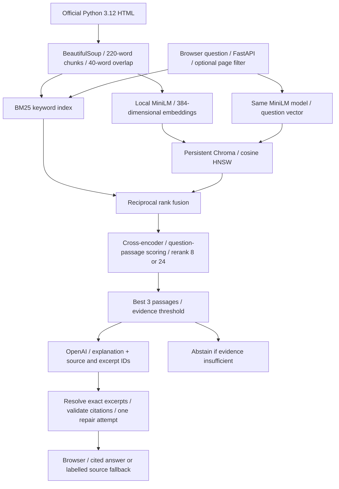

# Ask Python Docs - The Librarian

Project report - page 1; architecture design - page 2

## Objective and corpus

The Librarian helps students answer Python questions with cited evidence from official Python 3.12 documentation: 73 HTML pages, 784 sections and 2,632 chunks. It preserves section titles, version and source URLs. Chunks target 220 words with up to 40 words of overlap; this matched the larger 320-word configuration's development recall with shorter contexts.

## Evaluation and results

The 120-question dataset contains 55 answerable development cases, 55 answerable test paraphrases and 10 out-of-scope test cases. Symbol-based relevance labels require human review. The historical retrieval results below predate Chroma and must be rerun for the current architecture.

| Retrieval method | Recall@5 | MRR@5 | p95 (ms) |
|---|---:|---:|---:|
| BM25 | 0.945 | 0.852 | 9.0 |
| Dense vector | 0.909 | 0.772 | 19.8 |
| Hybrid fusion | 0.964 | 0.842 | 25.9 |
| Hybrid + reranker | 0.945 | 0.874 | 113.8 |

## Optimization

In the earlier Groq benchmark, reducing reranking from 24 to 8 candidates lowered end-to-end p95 from 6,930 to 5,452 ms (21.3%); the correctness proxy rose from 0.846 to 0.877. The proxy checks expected symbols and cited passages, not human semantic correctness. These results do not establish current OpenAI/Chroma performance; the recorded optimization target was not met.

## Limitations and next steps

Tables, nested definitions and long code can lose structure or exceed embedding limits. Citation checks do not prove semantic support; abstention uses a heuristic threshold. Shared development/test topics limit generalization claims. Next steps: human relevance and answer review, new Chroma/OpenAI benchmarks, user feedback and concurrent-load testing. Public deployment and user validation remain pending. Token usage is recorded; OpenAI cost requires configured prices.

## Architecture design

MiniLM runs inside the app (on the laptop or Hugging Face Space); it creates 384-dimensional vectors. Chroma stores vectors, text and source metadata. BM25 uses word frequency, term rarity and passage length; the cross-encoder reads each question-passage pair to rank relevance. Neither ranking score is calibrated confidence. OpenAI writes the explanation, while the app resolves selected excerpt IDs to exact source text. Citation checks do not establish semantic correctness. Optional Groq and extractive modes are supported. Docker builds the index; FastAPI serves the UI/API. Exact-query caching and serialized inference support operation; feedback is logged for manual review, without automatic retraining.

Source: official Python 3.12 documentation (https://docs.python.org/3.12/); design.md and recorded results/ experiments.
